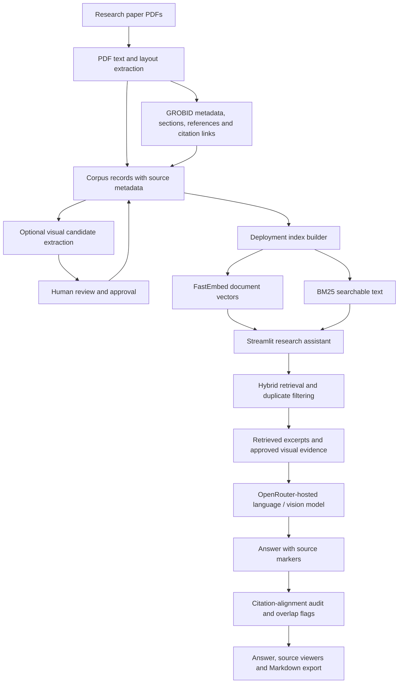

# Multimodal Research Paper Intelligence

An evidence-grounded research assistant for exploring three scientific papers. It combines dense retrieval with BM25 search, generates answers with source markers, supports bibliography lookups and cross-paper questions, and uses reviewed figure or table evidence when available.

**[Open the app](https://multimodalresearch.streamlit.app/)** · **[Source code](https://github.com/kamaleshpantra/multimodal-research-paper-rag)**

The application answers from its indexed paper collection; it is not a general-purpose web-search chatbot. Use the source panels to check generated answers against the underlying evidence.

## Features

- **Hybrid retrieval:** FastEmbed dense embeddings and BM25 keyword search are combined with reciprocal-rank fusion (RRF).
- **Source-aware answers:** Answers include markers such as `[S1]`. Expand a source to inspect the paper, section, page, metadata, and retrieved text.
- **Cross-paper questions:** Select an individual paper or search across the collection for comparisons and synthesis.
- **Bibliography lookup:** Exact-title questions can be answered from structured reference metadata when a matching entry exists.
- **Figure and table support:** Captions, extracted table records, and human-reviewed visual descriptions can be retrieved. Visual descriptions are used only after review and approval.
- **Cautious numeric checks:** For supported parameter-style questions, the app scans indexed text for explicit numeric assignments and flags values it cannot verify.
- **Answer review:** Citation-alignment heuristics and phrase-overlap flags help identify answers that need checking. They are review aids, not proof of entailment or plagiarism.
- **Markdown export:** Download an answer with supporting excerpts, warnings, and audit information.

## Research papers

The demo is scoped to the following three papers. Their topics provide complementary perspectives on retrieval-augmented generation, the internal computations of language models, and explainable recommendation.

### 1. Retrieval-Augmented Generation (RAG)

**Patrick Lewis et al. (2020). _Retrieval-Augmented Generation for Knowledge-Intensive NLP Tasks._ NeurIPS 2020.**

Introduces a generator that combines a pre-trained language model with an external, non-parametric document memory. The indexed paper supports questions about the retriever/generator workflow, RAG-Sequence versus RAG-Token, and its experiments and findings.

- [Paper on arXiv](https://arxiv.org/abs/2005.11401)
- [NeurIPS paper page](https://papers.neurips.cc/paper/2020/hash/6b493230205f780e1bc26945df7481e5-Abstract.html)

### 2. Mechanistic interpretability

**Daking Rai, Yilun Zhou, Shi Feng, Abulhair Saparov, and Ziyu Yao (2024). _A Practical Review of Mechanistic Interpretability for Transformer-Based Language Models._ arXiv:2407.02646.**

Reviews approaches for studying the internal computations of transformer language models, including interpretability objects, techniques, evaluation methods, limitations, and open research directions.

- [Paper on arXiv](https://arxiv.org/abs/2407.02646)

### 3. Explainable recommendation

**Qiyao Ma, Xubin Ren, and Chao Huang (2024). _XRec: Large Language Models for Explainable Recommendation._ Findings of EMNLP 2024, pp. 391–402.**

Presents XRec, a framework that combines collaborative signals with large language models to produce explanations for recommendations. The indexed paper supports questions about the collaborative adaptor, user–item signals, explanation generation, and the reported methods and experiments.

- [Paper in the ACL Anthology](https://aclanthology.org/2024.findings-emnlp.22/)
- [arXiv version](https://arxiv.org/abs/2406.02377)

## Questions to try in the app

Use these example prompts to check different parts of the RAG workflow. Select the named paper in the app for single-paper questions, and choose **all papers** for cross-paper synthesis. Answers can vary with retrieval results; open the source panels and verify important claims against the cited excerpts.

### Single-paper retrieval

**Select the RAG paper**
- How does RAG combine parametric and non-parametric memory to answer knowledge-intensive questions?
- What is the difference between RAG-Sequence and RAG-Token?
- What quantitative evidence does the paper report when comparing RAG with its baselines?

**Select the mechanistic interpretability review**
- Which interpretability objects and techniques does the review discuss, and what limitations or open challenges does it identify?
- How does mechanistic interpretability aim to understand a transformer's internal computations?

**Select the XRec paper**
- How does XRec combine collaborative signals with a large language model to produce explainable recommendations?
- What role does the collaborative adaptor play in the XRec framework?

### Cross-paper synthesis

**Select all papers**
- Compare how RAG and XRec use retrieved information or collaborative signals to condition model outputs. What is similar, and what is different?
- How does retrieval-based grounding in the RAG paper differ from the goal of understanding internal model computations in the mechanistic interpretability review?
- What limitations or open research questions are discussed across the three papers? Separate each paper's claims rather than assuming they reach the same conclusion.

### Bibliography lookup

- Find the exact bibliography entry for “Retrieval-Augmented Generation for Knowledge-Intensive NLP Tasks.”
- What publication venue and year are listed for “XRec: Large Language Models for Explainable Recommendation”?

### Figures, tables, and evidence checks

- In the XRec paper, explain the framework diagram and the role of the collaborative adaptor. Use the caption and approved visual description if one is available in the index.
- Summarize what the RAG paper's results table reports about performance compared with its baselines. Only include values supported by retrieved evidence.
- Which retrieved passages support the main claims in your answer? Open the source panels and check whether each citation actually supports the claim.

### Abstention check

- According to these papers, what is the current weather in Coimbatore?

This last question is intentionally outside the paper collection. A good result should state that the indexed papers do not provide that information rather than inventing an answer.

These prompts are smoke tests, not a benchmark. For formal evaluation, use held-out questions with manually reviewed relevance labels and assess retrieval, answer correctness, citation support, and abstention separately.

### Paper sources and redistribution

The repository links to the papers' publisher or preprint pages instead of including the original PDFs. The prebuilt deployment index can still contain extracted text and reviewed figure crops, so check each paper's license and redistribution terms before sharing those files publicly. For local ingestion, place permitted PDF copies in `data/selected_papers/`. The current `.gitignore` allows PDF files in that folder to be tracked, so do not commit them unless redistribution is permitted; check `git status --short` before pushing.

## Architecture



### Request flow

1. The reader enters a question and chooses one paper or all papers.
2. The app embeds the question with the same FastEmbed model used to build the deployment index, then combines dense results with BM25 results using RRF.
3. Near-duplicate text records from separate extraction paths are filtered to reduce redundant evidence.
4. Exact bibliography-title lookups and selected numeric-parameter checks can use structured metadata or deterministic text scans.
5. Retrieved text, metadata, and relevant approved visual crops are sent to the configured hosted model.
6. The app displays the answer, supporting sources, citation-alignment audit, and any warnings.

## Technology stack

| Area | Technology | Purpose |
|---|---|---|
| Interface | Streamlit | Question form, paper selector, answers, source viewer, warnings, and report download |
| Language | Python 3.11 | App, retrieval, ingestion utilities, evaluation, and tests |
| Dense retrieval | FastEmbed with `BAAI/bge-base-en-v1.5` by default | Local ONNX embeddings for the deployed app |
| Keyword retrieval | BM25 | Matches keywords and technical phrases |
| Ranking | NumPy, cosine similarity, reciprocal-rank fusion | Combines dense and keyword rankings |
| Answer generation | OpenRouter API; default model `nvidia/nemotron-3.5-super-vl:free` | Generates evidence-conditioned answers and processes selected images |
| PDF extraction | PyMuPDF | Text, page information, and figure/table candidates |
| Scientific parsing | GROBID | Metadata, sections, references, and in-text citation links in the ingestion workflow |
| Local experiments | Ollama, Qwen models, and BGE-M3 where configured | Local answer-generation and retrieval experiments |
| Image handling | Pillow | Stages and displays reviewed image crops |
| Evaluation | Python scripts and a labeled JSONL seed set | Retrieval evaluation and per-question reports |

**Embedding-model requirement:** the deployed app uses FastEmbed and OpenRouter; it does not call the local Ollama server. The separate local experiment path can use Ollama and BGE-M3. Do not mix embeddings from different models. Rebuild the deployment index if its configured embedding model changes.

## Repository layout

```text
.
├── app.py
├── audit_visual_records.py
├── merge_approved_vision.py
├── requirements.txt
├── runtime.txt
├── .gitignore
├── src/
│   ├── ingestion/
│   ├── retrieval/
│   ├── generation/
│   └── evaluation/
├── tests/
└── data/
    └── deployment_index/   # Runtime retrieval data required by the app
```

The deployment index contains the searchable records, embeddings, paper registry, manifest, and any included reviewed visual assets. It must be present at runtime unless the application is changed to load it from another storage location.

## Run locally

### Requirements

- Python 3.11
- Git
- Internet access for the initial embedding-model download and hosted answer-generation requests
- An OpenRouter API key
- The built `data/deployment_index/` directory

### 1. Clone the repository

```bash
git clone https://github.com/kamaleshpantra/multimodal-research-paper-rag.git
cd multimodal-research-paper-rag
```

### 2. Create an environment and install dependencies

**Windows PowerShell:**

```powershell
py -3.11 -m venv .venv
.\.venv\Scripts\Activate.ps1
python -m pip install --upgrade pip
python -m pip install -r requirements.txt
```

**macOS / Linux:**

```bash
python3.11 -m venv .venv
source .venv/bin/activate
python -m pip install --upgrade pip
python -m pip install -r requirements.txt
```

### 3. Configure the API key

For a quick local test in Windows PowerShell, set the key and optional model settings in the current terminal session:

```powershell
$env:OPENROUTER_API_KEY = "YOUR_OPENROUTER_KEY"
$env:OPENROUTER_MODEL = "nvidia/nemotron-3.5-super-vl:free"
$env:DEPLOY_EMBED_MODEL = "BAAI/bge-base-en-v1.5"
```

The embedding setting must match the model recorded in `data/deployment_index/index_manifest.json`. Never put a real API key in the README, source code, screenshots, or a Git commit.

### 4. Start the app

```powershell
streamlit run app.py
```

Open the local URL printed in the terminal. The app reads the key from its environment or Streamlit secrets; users of the app do not need to enter the key themselves.

### If the deployment index is missing

The app requires `data/deployment_index/`. To rebuild it, the builder needs the processed corpus (normally `data/processed/corpus.jsonl`) and available GROBID metadata. Make sure the source PDFs and derived assets can be used and shared under their applicable terms before generating or publishing a new index.

```powershell
python src\retrieval\build_deployment_index.py
```

The builder writes `records.jsonl`, `embeddings.npy`, `index_manifest.json`, `paper_registry.json`, and, when available, an `assets/` directory for reviewed visual crops.

## Deployment

The app is configured for Streamlit Community Cloud. In the app's **Settings → Secrets**, set the following values using your own key:

```toml
OPENROUTER_API_KEY = "YOUR_OPENROUTER_KEY"
OPENROUTER_MODEL = "nvidia/nemotron-3.5-super-vl:free"
DEPLOY_EMBED_MODEL = "BAAI/bge-base-en-v1.5"
```

Keep `data/deployment_index/` available to the deployed app. After changing the index or embedding model, redeploy and test at least a normal text question, a bibliography lookup, a cross-paper question, a question about a reviewed figure, and a question that cannot be answered from the indexed evidence.

- [Streamlit Community Cloud](https://share.streamlit.io/)
- [Streamlit deployment guide](https://docs.streamlit.io/deploy/streamlit-community-cloud/deploy-your-app)
- [Streamlit secrets guide](https://docs.streamlit.io/deploy/streamlit-community-cloud/deploy-your-app/secrets-management)

## Evaluation and tests

Run the available syntax and unit-test checks from the repository root:

```powershell
python -m py_compile app.py src\retrieval\deployment_rag.py src\retrieval\build_deployment_index.py src\generation\answer_generator.py src\ingestion\vision_index.py src\ingestion\approve_vision_records.py src\evaluation\evaluate_deployment_index.py
python tests\test_answer_generator_citation_audit.py
python -m unittest tests.test_deployment_rag -v
```

To evaluate the deployment index after it has been built:

```powershell
python src\evaluation\evaluate_deployment_index.py --top-k 8
```

The evaluation script writes a per-run JSON report and a Markdown summary under `data/evaluation/deployment_runs/`.

**Evaluation limitations:** the included seed set is small and its relevance labels need manual review. Add held-out questions before treating results as benchmark-quality metrics. Hit@K, Recall@K, MRR, and nDCG measure retrieval ranking; they do not establish answer correctness, citation entailment, visual-reading accuracy, or abstention quality. Inspect generated answers separately.

## Limitations and privacy

- A citation marker being present does not prove that the cited source entails the claim. Citation-alignment scores are heuristics and require human review.
- Phrase-overlap flags are prompts for manual review, not a plagiarism verdict.
- Visual descriptions must be checked against the original crop. Model-generated descriptions can misread axes, labels, arrows, units, or values; only approved visual records are indexed.
- A numeric value not found in the indexed text may still appear in an unparsed equation, image, table, or omitted passage.
- The free OpenRouter model may be subject to availability limits, rate limits, or changes in provider terms. Check the provider's [model page](https://openrouter.ai/nvidia/nemotron-3.5-super-vl%3Afree) before a demo.
- Questions, retrieved excerpts, and selected reviewed images are sent to the configured hosted inference provider. Do not submit confidential, unpublished, or sensitive material to the public demo.

## Security checklist

Before committing, inspect the files Git will include:

```bash
git status --short
```

Do not commit API keys, `.env` files, `.streamlit/secrets.toml`, virtual environments, caches, or local model weights. Do not publish source PDFs or extracted text/image material unless redistribution is permitted. Local experiment indexes and temporary evaluation outputs should remain excluded from Git. The deployed app still needs `data/deployment_index/` unless its loading design is changed.

## Acknowledgements

- [Streamlit](https://streamlit.io/) — application framework
- [FastEmbed](https://github.com/qdrant/fastembed) — embedding generation
- [GROBID](https://github.com/kermitt2/grobid) — scientific document parsing in the ingestion workflow
- [PyMuPDF](https://pymupdf.readthedocs.io/) — PDF extraction
- [OpenRouter](https://openrouter.ai/) — hosted model API
